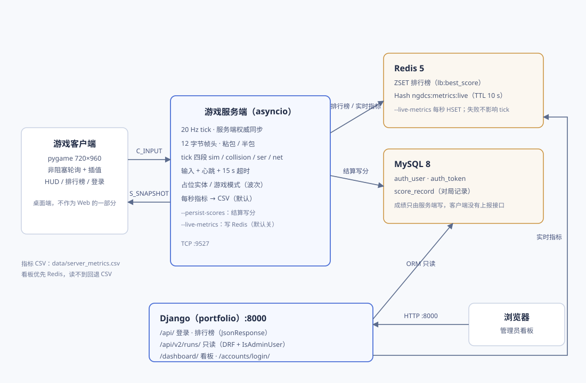
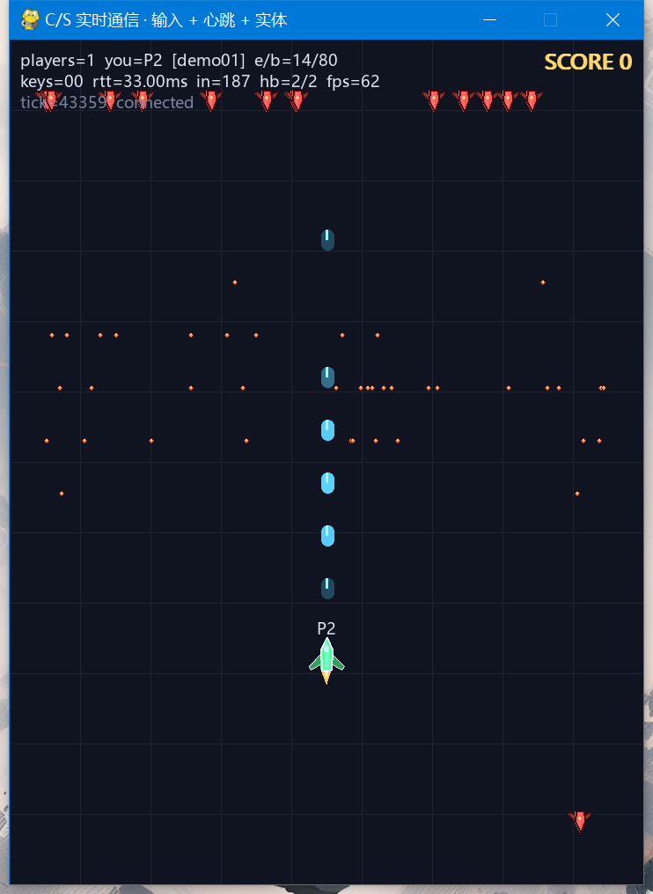
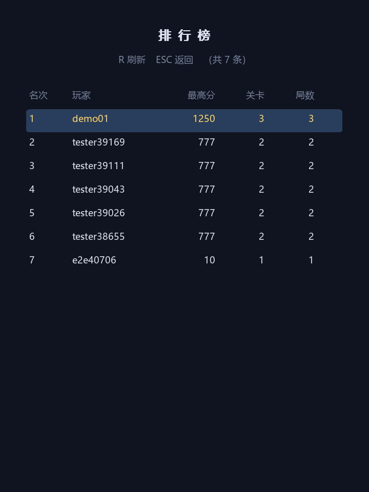
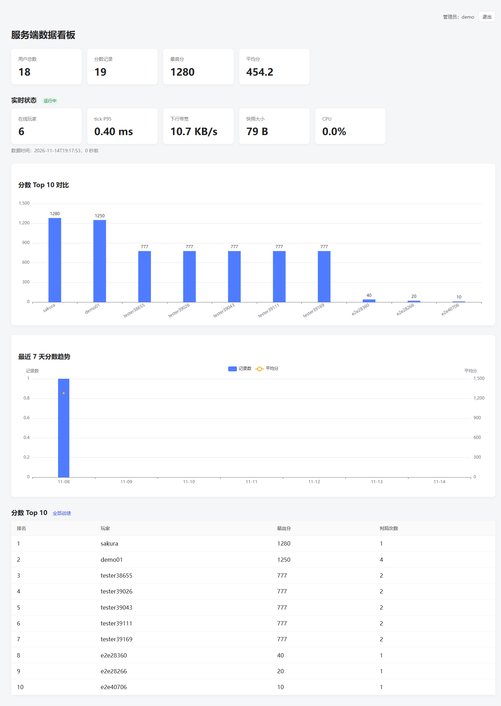
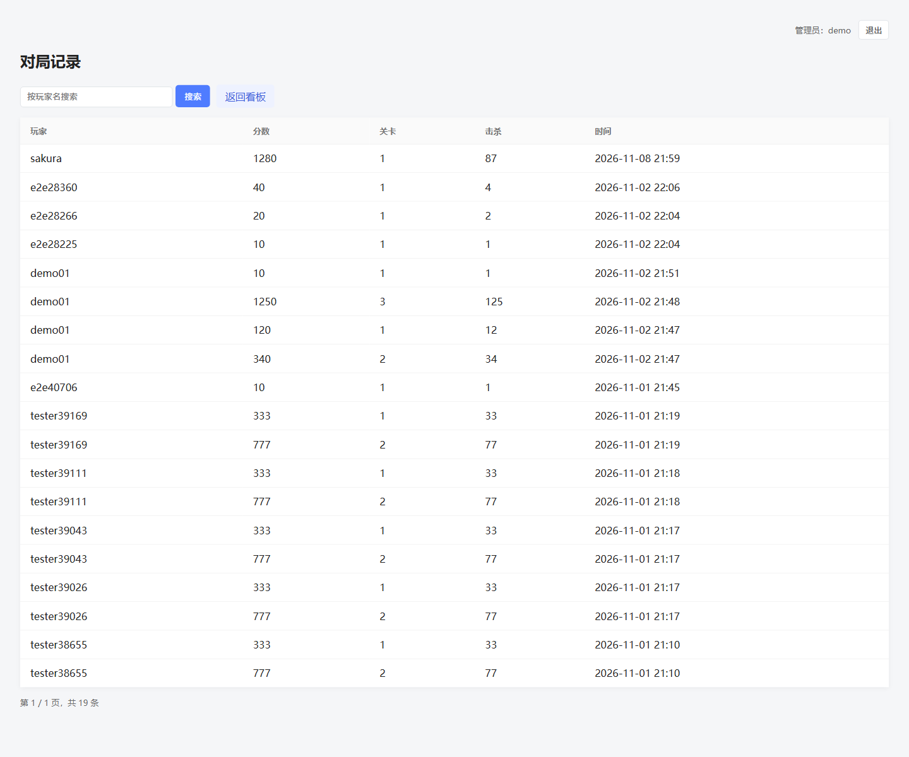
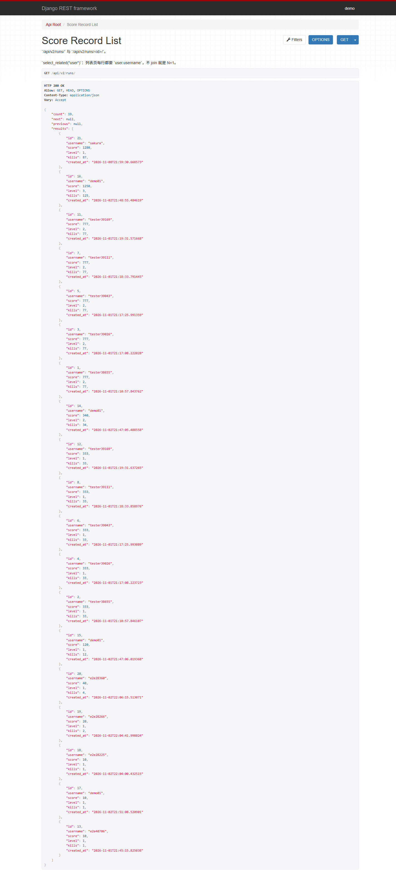
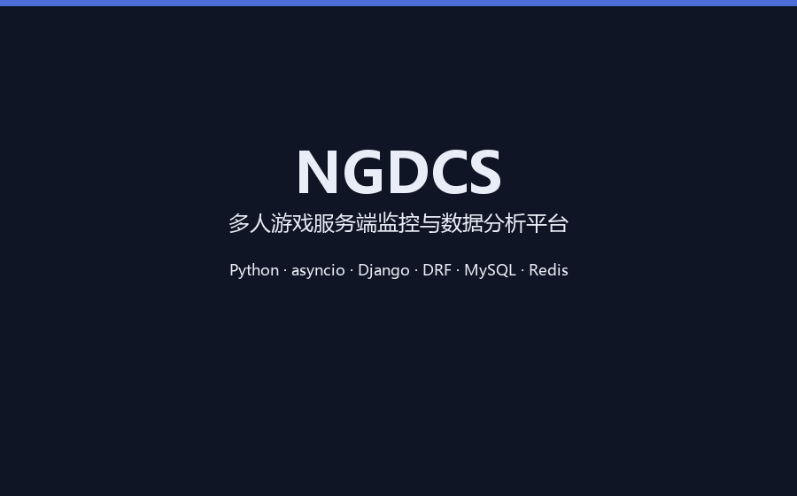

# NGDCS · 实时游戏服务端与监控平台

> 一个 C/S 实时游戏通信系统，加一个只读的对局监控与数据分析平台。
> 服务端 20 Hz 广播全量快照，客户端插值渲染；看板把运行指标、对局记录和趋势画出来。



**技术栈**：Python 3.13 · asyncio · pygame · Django 5.2 · DRF · MySQL 8 · Redis · Docker Compose · nginx

---

## 项目一：C/S 实时游戏通信系统

- **自定义二进制协议**：12 字节帧头（magic / version / type / seq / length），处理 TCP 粘包、半包、超大包
- **asyncio 服务端**：20 Hz tick、服务端权威坐标、输入意图上报、心跳与 15 s 超时
- **pygame 客户端**：720×960、非阻塞 socket、一帧线性插值、HUD
- **压测机器人**：观察者 / 输入 / 心跳三种模式，汇总快照间隔、RTT 与错误数





---

## 项目二：Django 监控与数据分析平台

- **只读看板**：管理员登录、对局记录分页与按玩家名搜索、Top 10、最近 7 天趋势
- **实时指标**：在线人数、tick P95、下行带宽、快照大小、CPU；优先读 Redis（TTL 10 s），读不到回退 CSV 最后一行
- **只读 API**：`/api/v2/runs/`，DRF 序列化 + 分页 + 搜索 + 排序 + 管理员权限







演示（启动 → 登录 → 看板 → 对局记录 → API）：



---

## 技术栈

| 层 | 选型 | 说明 |
|---|---|---|
| 实时服务端 | Python 3.13 + asyncio | 单线程事件循环，20 Hz tick |
| 协议 | 自定义二进制 | 12 字节帧头，解决粘包 / 半包 |
| 客户端 | pygame | 720×960，非阻塞 socket + 插值 |
| Web | Django 5.2 + DRF | JSON 接口 + 一个只读资源 |
| 数据库 | MySQL 8 | `auth_user` / `auth_token` / `score_record` |
| 缓存 | Redis | 排行榜 ZSET + 实时指标 Hash |
| 部署 | Docker Compose + nginx + gunicorn | 可选，见下文 |

---

## 快速开始

### 前置

- Python 3.13
- MySQL 8（库 `myproject`，用户 `django_user`）
- Redis 5+（可选：排行榜与实时指标；没有也能跑，看板回退 CSV）

### 启动

```powershell
cd NGDCS-portfolio

# 1) 依赖（务必带镜像源）
python -m pip install -r requirements.txt `
    -i https://pypi.tuna.tsinghua.edu.cn/simple --no-cache-dir --progress-bar off

# 2) 配置：复制 .env.example 为 .env，填随机 SECRET_KEY 和本地 MySQL 密码
copy .env.example .env

# 3) 建表
python manage.py migrate

# 4) 管理员（或直接灌演示数据，见下）
python manage.py createsuperuser

# 5) Django
python manage.py runserver 127.0.0.1:8000

# 6) 游戏服务端（另开窗口）
python -X utf8 -m server.main --game-mode --persist-scores

# 7) 客户端（另开窗口）
python -X utf8 -m client.main
```

打开 <http://127.0.0.1:8000/dashboard/>，用管理员账号登录。

实时指标（可选）：Redis 在跑时，服务端加 `--live-metrics`。

### 演示数据（可选）

```powershell
$env:DEMO_PASSWORD = "自己设一个"
python manage.py seed_demo
```

生成 `demo` 管理员（staff）+ 5 个 `demo_` 玩家 + 35 条对局，重复执行会重建而不是累加。

> 一键脚本：`tools\start_game.bat`（服务端 + Django + 客户端）、
> `tools\start_dashboard.bat`（只起 Django 看板）。

---

## 测试

```powershell
# 主测试（协议 / 服务端 / 机器人 / 指标 / 实验回归）
python -X utf8 -m unittest discover -s tests

# Django 测试（账号 / 看板 / DRF / 演示数据）
python manage.py test accounts dashboard --noinput

# 黄金基线（默认实验路径的 SHA256 锁）
python -X utf8 -m unittest tests.test_golden_baseline

# 实验回归（硬 13 + 软 11）
python -X utf8 -m tools.check_experiments
```

```text
主测试     491 passed
Django     52 passed
黄金基线   SHA256 7860bdb9…
实验回归   24/24
```

---

## 接口

| 方法 | 路径 | 权限 | 说明 |
|---|---|---|---|
| POST | `/api/auth/register` | 公开 | 注册并发 token |
| POST | `/api/auth/login` | 公开 | 登录 |
| GET | `/api/leaderboard` | 公开 | 排行榜（Redis 优先，MySQL 兜底） |
| GET | `/api/v2/runs/` | 管理员 | 对局记录：分页 / `search` / `ordering` |
| GET | `/api/v2/runs/<id>/` | 管理员 | 单条对局 |

```text
GET /api/v2/runs/?page=2&page_size=50&search=demo&ordering=-score
```

---

## 目录结构

```text
protocol/    帧、快照编解码、编码器（binary / binary_fast / json）
server/      asyncio 服务端、实体、运动学、CSV 指标、Redis 实时指标
client/      pygame 客户端（渲染 / 插值 / 输入 / 心跳）
bot/         压测机器人
accounts/    用户、token、成绩、排行榜、DRF 只读接口、seed_demo
dashboard/   看板视图与模板
webapp/      Django 配置与路由
tools/       实验跑批、出图、回归检查、录屏
tests/       主测试与黄金基线
deploy/      nginx 配置、容器入口脚本
docs/        架构图、截图、演示 GIF
```

---

## Docker Compose（可选）

```bash
cp .env.example .env      # 填 SECRET_KEY、MySQL 密码
docker compose up -d --build
docker compose exec web python manage.py seed_demo   # 可选
```

服务：MySQL 8、Redis 7、Django（gunicorn）、nginx。
对外只暴露 80；3306 / 6379 只绑 `127.0.0.1`；静态文件由 nginx 提供。

> 本项目未上线，Compose 只用于本地一键起环境。

---

## 说明

- 成绩只由服务端写，客户端没有上报接口。
- 截图与演示来自本地真实运行；`demo01`、`demo_*` 是演示数据。
- 管理员密码、数据库密码只存在本地 `.env` 或环境变量里，不进入仓库。
